<div align="center">

  <!-- ================= MOONLIT SAKURA CHŌCHIN LANTERN HERO HEADER (DYNAMIC LIGHT / DARK ADAPTIVE) ================= -->
  <picture>
    <source media="(prefers-color-scheme: dark)" srcset="assets/header-dark.svg">
    <source media="(prefers-color-scheme: light)" srcset="assets/header-light.svg">
    
  </picture>

  <br/><br/>

  <!-- QUICK ACTION PILLS (PORTFOLIO, LINKEDIN, EMAIL) -->
  <p align="center">
    <a href="https://thiya-portfolio.vercel.app/" target="_blank">
      
    </a>
    &nbsp;
    <a href="https://www.linkedin.com/in/santhiya-b-" target="_blank">
      
    </a>
    &nbsp;
    <a href="mailto:santhiyab010@gmail.com">
      
    </a>
    &nbsp;
    <a href="https://github.com/santhiyab010" target="_blank">
      
    </a>
  </p>

  <!-- JAPANESE FLORAL KAMON DIVIDER -->
  <picture>
    <source media="(prefers-color-scheme: dark)" srcset="assets/divider-dark.svg">
    <source media="(prefers-color-scheme: light)" srcset="assets/divider-light.svg">
    
  </picture>

</div>

## 🌸 About Me // システム概要

```
╔════════════════════════════════════════════════════════════════════════════╗
║  NAME: Santhiya B             LOCATION: Tamil Nadu, India                  ║
║  STATUS: B.Tech ECE (3rd Sem) KALASALINGAM ACADEMY (CGPA: 9.23 / 10.0)     ║
║  CORE FOCUS: VLSI Frontend, RTL Architecture & Verilog HDL                 ║
║  SECONDARY:  Embedded IoT Systems, LoRa Wireless & Full-Stack Web Dev      ║
╚════════════════════════════════════════════════════════════════════════════╝
```

- 🎓 **Academic Excellence**: Currently pursuing **B.Tech in Electronics and Communication Engineering** at **Kalasalingam Academy of Research and Education** with an outstanding **9.23 CGPA** (3rd Semester).
- 🏫 **Foundation**: Completed Higher Secondary Education at **Sri Matha Matriculation Higher Secondary School** with **90.16%**.
- ⚡ **Primary Focus — VLSI & Digital Logic**: Passionate about digital frontend design, RTL architecture with **Verilog HDL**, digital synthesis, and understanding semiconductor foundations from gates to silicon.
- 📡 **Secondary Passion — Embedded Systems & IoT**: Building real-world hardware prototypes using **LoRa wireless communication**, **ESP32**, **microcontrollers**, and sensor telemetry networks.
- 💻 **Full-Stack Development**: Crafting performant, aesthetic web applications with **React**, **JavaScript**, **Tailwind CSS**, and modern software pipelines.
- 🎯 **Current Mission**: Deepening expertise in ASIC/FPGA digital design flows, testbench verification, and hardware-software co-design.

<br/>

<div align="center">
  <!-- ABOUT ME METRIC CARD -->
  <picture>
    <source media="(prefers-color-scheme: dark)" srcset="assets/about-dark.svg">
    <source media="(prefers-color-scheme: light)" srcset="assets/about-light.svg">
    
  </picture>
</div>

<br/>

<div align="center">
  <picture>
    <source media="(prefers-color-scheme: dark)" srcset="assets/divider-dark.svg">
    <source media="(prefers-color-scheme: light)" srcset="assets/divider-light.svg">
    
  </picture>
</div>

## ⚡ Silicon & Software Console // ハードウェア定義

```verilog
// =========================================================================
//  Module: engineer_santhiya
//  Description: RTL Hardware representation of engineering passion & skills
// =========================================================================
module engineer_santhiya #(
    parameter integer CGPA_X100  = 923,        // 9.23 CGPA (KARE)
    parameter string  CORE_FIELD = "VLSI_RTL", // Primary focus
    parameter string  PASSION    = "UNBOUNDED"
)(
    input  wire        clk_curiosity,     // Driven by relentless exploration
    input  wire        rst_never_give_up, // Active-low perseverance
    output reg  [31:0] silicon_cycles,
    output wire [3:0]  flagship_builds,   // SOS Watch, Patient Monitor, Smart Warehouse, PMSM
    output wire        rtl_timing_met     // Always optimal slack!
);

    assign flagship_builds = 4'b1111;    // All 4 builds operational
    assign rtl_timing_met  = 1'b1;       // Zero timing violations

    always @(posedge clk_curiosity or negedge rst_never_give_up) begin
        if (!rst_never_give_up) begin
            silicon_cycles <= 32'h0;
        end else begin
            silicon_cycles <= silicon_cycles + 1'b1; // Continuous learning & growth
        end
    end

endmodule
```

<br/>

<div align="center">
  <picture>
    <source media="(prefers-color-scheme: dark)" srcset="assets/divider-dark.svg">
    <source media="(prefers-color-scheme: light)" srcset="assets/divider-light.svg">
    
  </picture>
</div>

## 🛠️ Tech Arsenal & Engineering Lab // 技術スタック

<div align="center">
  <!-- SKILLS GRAPHIC CARD -->
  <picture>
    <source media="(prefers-color-scheme: dark)" srcset="assets/skills-dark.svg">
    <source media="(prefers-color-scheme: light)" srcset="assets/skills-light.svg">
    
  </picture>
</div>

<br/>

### ✦ Hardware, VLSI & Simulation


### ✦ Programming & Embedded Systems


### ✦ Web Development & Developer Ecosystem


<br/>

<div align="center">
  <picture>
    <source media="(prefers-color-scheme: dark)" srcset="assets/divider-dark.svg">
    <source media="(prefers-color-scheme: light)" srcset="assets/divider-light.svg">
    
  </picture>
</div>

## 🚀 Featured Engineering Projects // 主要プロジェクト

<div align="center">
  <!-- PROJECTS GRAPHIC CARD -->
  <picture>
    <source media="(prefers-color-scheme: dark)" srcset="assets/projects-dark.svg">
    <source media="(prefers-color-scheme: light)" srcset="assets/projects-light.svg">
    
  </picture>
</div>

<br/>

| Project | Domain | Architecture Highlights | Impact |
|:---|:---:|:---|:---:|
| **📡 SOS Watch** | `Embedded IoT` `LoRa` | Long-range 868MHz wireless packet transceiver, emergency beacon triggers, low-power sleep cycles | Enables off-grid emergency alerts without cellular infrastructure |
| **💓 Patient Monitor** | `Biometric IoT` `Telemetry` | ESP32 wireless telemetry streaming continuous SpO2, heart rate & temperature data with sub-second latency | Real-time clinical monitoring with automated alert thresholds |
| **🤖 Smart Warehouse** | `Automation` `Sensors` | Optical package detection & conveyor routing pipeline with hardware counters and logic-gated verification | Slashes manual package auditing time & human error by >80% |
| **⚡ PMSM Motor Control** | `Control Systems` `MATLAB` | Field-Oriented Control (FOC) with adaptive dynamic PID parameter tuning in MATLAB & Simulink | High-efficiency torque regulation with minimal harmonic distortion |

<br/>

<div align="center">
  <picture>
    <source media="(prefers-color-scheme: dark)" srcset="assets/divider-dark.svg">
    <source media="(prefers-color-scheme: light)" srcset="assets/divider-light.svg">
    
  </picture>
</div>

## 🎓 Academic Journey // 学歴・専攻

<div align="center">
  <!-- EDUCATION GRAPHIC CARD -->
  <picture>
    <source media="(prefers-color-scheme: dark)" srcset="assets/education-dark.svg">
    <source media="(prefers-color-scheme: light)" srcset="assets/education-light.svg">
    
  </picture>
</div>

<br/>

- 🏛️ **B.Tech — Electronics & Communication Engineering**
  - **Institution**: Kalasalingam Academy of Research and Education (KARE)
  - **Semester**: 3rd Semester
  - **Cumulative GPA**: **9.23 / 10.0**
  - **Key Coursework**: Digital Logic & Microprocessors, Semiconductor Devices, Electronic Circuits, Signals & Systems, Linear Integrated Circuits.

- 🏫 **Higher Secondary Education (12th Grade)**
  - **Institution**: Sri Matha Matriculation Higher Secondary School
  - **Score**: **90.16%**
  - **Focus**: Physics, Chemistry, Mathematics & Computer Science.

<br/>

<div align="center">
  <picture>
    <source media="(prefers-color-scheme: dark)" srcset="assets/divider-dark.svg">
    <source media="(prefers-color-scheme: light)" srcset="assets/divider-light.svg">
    
  </picture>
</div>

## 🎐 Japanese Philosophy & Engineering Creed // 理念

> ### 「七転び八起き」 — *Nana korobi, ya oki*
> *(Fall seven times, stand up eight)*
>
> *"Turning Boolean equations into physical silicon, and embedded sensor telemetry into intuitive software experiences. Engineering is the bridge between theoretical physics and human empowerment."*

<br/>

<div align="center">

  <!-- ================= CONTACT & GET IN TOUCH ================= -->
  <h3>🌸 Let's Collaborate &amp; Build Together 🌸</h3>
  <p>Interested in collaborating on VLSI frontend designs, Verilog testbenches, embedded IoT builds, or web platforms? Feel free to reach out!</p>

  <p align="center">
    <a href="https://thiya-portfolio.vercel.app/" target="_blank">
      
    </a>
    &nbsp;
    <a href="https://www.linkedin.com/in/santhiya-b-" target="_blank">
      
    </a>
    &nbsp;
    <a href="mailto:santhiyab010@gmail.com">
      
    </a>
    &nbsp;
    <a href="https://github.com/santhiyab010" target="_blank">
      
    </a>
  </p>

  <br/>

  <p align="center">
    <sub>SANTHIYA.EXE • Crafted with curiosity, code &amp; silicon • 🌸 Japanese Sakura Theme (Light &amp; Dark Adaptive)</sub>
  </p>

</div>
