  <!-- ================= AUTHENTIC JAPANESE SAKURA HERO HEADER (DYNAMIC LIGHT / DARK MODE) ================= -->
  <picture>
    <source media="(prefers-color-scheme: dark)" srcset="assets/header-dark.svg">
    <source media="(prefers-color-scheme: light)" srcset="assets/header-light.svg">
    
  </picture>

    

  <!-- QUICK ACTION PILLS (PORTFOLIO, LINKEDIN, EMAIL, GITHUB) -->
  

    
    &nbsp;
    
    &nbsp;
    
    &nbsp;
    
  

  <!-- JAPANESE FLORAL KAMON DIVIDER -->
  <picture>
    <source media="(prefers-color-scheme: dark)" srcset="assets/divider-dark.svg">
    <source media="(prefers-color-scheme: light)" srcset="assets/divider-light.svg">
    
  </picture>

    

  <!-- ABOUT ME SECTION (DYNAMIC LIGHT / DARK MODE) -->
  <picture>
    <source media="(prefers-color-scheme: dark)" srcset="assets/about-dark.svg">
    <source media="(prefers-color-scheme: light)" srcset="assets/about-light.svg">
    
  </picture>

    

  <!-- JAPANESE FLORAL KAMON DIVIDER -->
  <picture>
    <source media="(prefers-color-scheme: dark)" srcset="assets/divider-dark.svg">
    <source media="(prefers-color-scheme: light)" srcset="assets/divider-light.svg">
    
  </picture>

    

  <!-- TECHNICAL PROFICIENCIES & SKILLS DATABASE (DYNAMIC LIGHT / DARK MODE) -->
  <picture>
    <source media="(prefers-color-scheme: dark)" srcset="assets/skills-dark.svg">
    <source media="(prefers-color-scheme: light)" srcset="assets/skills-light.svg">
    
  </picture>

    

  <!-- JAPANESE FLORAL KAMON DIVIDER -->
  <picture>
    <source media="(prefers-color-scheme: dark)" srcset="assets/divider-dark.svg">
    <source media="(prefers-color-scheme: light)" srcset="assets/divider-light.svg">
    
  </picture>

    

  <!-- ACADEMIC BACKGROUND (DYNAMIC LIGHT / DARK MODE) -->
  <picture>
    <source media="(prefers-color-scheme: dark)" srcset="assets/education-dark.svg">
    <source media="(prefers-color-scheme: light)" srcset="assets/education-light.svg">
    
  </picture>

    

  <!-- JAPANESE FLORAL KAMON DIVIDER -->
  <picture>
    <source media="(prefers-color-scheme: dark)" srcset="assets/divider-dark.svg">
    <source media="(prefers-color-scheme: light)" srcset="assets/divider-light.svg">
    
  </picture>

    

  <!-- ================= CONTACT & PHILOSOPHY FOOTER ================= -->
  <h3>🌸 Let's Connect &amp; Collaborate 🌸</h3>
  

    Interested in collaborating on VLSI frontend designs, embedded hardware, or web platforms? Feel free to reach out!
  

  

    
    &nbsp;
    
    &nbsp;
    
  

   

  

    「七転び八起き」 • SANTHIYA.EXE • 🌸 Authentic Japanese Sakura Theme (Light &amp; Dark Adaptive)
  

