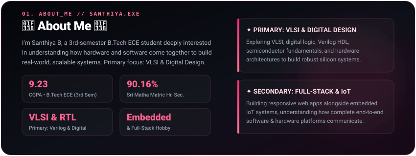
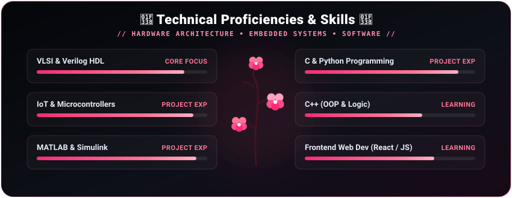
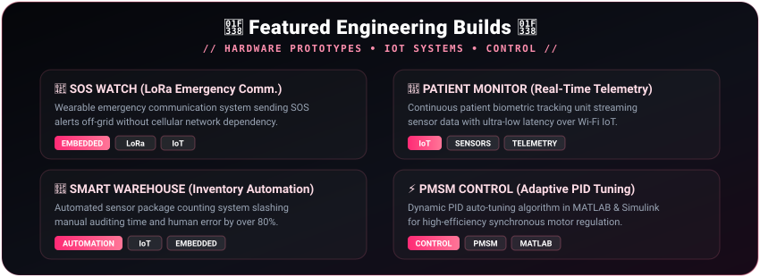
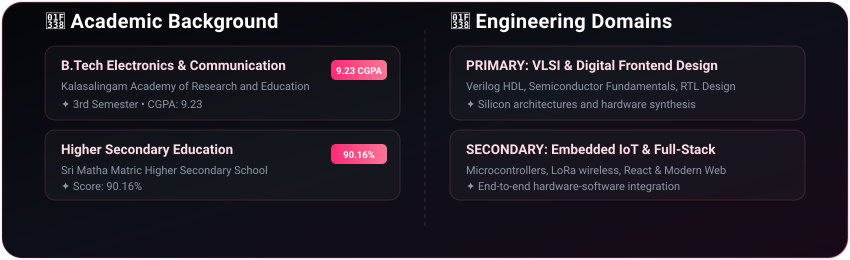

  <!-- ANIMATED JAPANESE SAKURA HEADER (DYNAMIC LIGHT / DARK THEME) -->
  <picture>
    <source media="(prefers-color-scheme: dark)" srcset="assets/header-dark.svg">
    <source media="(prefers-color-scheme: light)" srcset="assets/header-light.svg">
    
  </picture>

    

  <!-- QUICK ACTION PILLS (WITH LIVE PORTFOLIO) -->
  

    
    &nbsp;
    
    &nbsp;
    
  

  <!-- JAPANESE FLORAL DIVIDER -->
  <picture>
    <source media="(prefers-color-scheme: dark)" srcset="assets/divider-dark.svg">
    <source media="(prefers-color-scheme: light)" srcset="assets/divider-light.svg">
    
  </picture>

<!-- ABOUT ME SECTION -->

  <picture>
    <source media="(prefers-color-scheme: dark)" srcset="assets/about-dark.svg">
    <source media="(prefers-color-scheme: light)" srcset="assets/about-light.svg">
    
  </picture>

 

  <picture>
    <source media="(prefers-color-scheme: dark)" srcset="assets/divider-dark.svg">
    <source media="(prefers-color-scheme: light)" srcset="assets/divider-light.svg">
    
  </picture>

<!-- TECHNICAL PROFICIENCIES & SKILLS DATABASE -->

  <picture>
    <source media="(prefers-color-scheme: dark)" srcset="assets/skills-dark.svg">
    <source media="(prefers-color-scheme: light)" srcset="assets/skills-light.svg">
    
  </picture>

 

  <picture>
    <source media="(prefers-color-scheme: dark)" srcset="assets/divider-dark.svg">
    <source media="(prefers-color-scheme: light)" srcset="assets/divider-light.svg">
    
  </picture>

<!-- FEATURED ENGINEERING BUILDS -->

  <picture>
    <source media="(prefers-color-scheme: dark)" srcset="assets/projects-dark.svg">
    <source media="(prefers-color-scheme: light)" srcset="assets/projects-light.svg">
    
  </picture>

 

  <picture>
    <source media="(prefers-color-scheme: dark)" srcset="assets/divider-dark.svg">
    <source media="(prefers-color-scheme: light)" srcset="assets/divider-light.svg">
    
  </picture>

<!-- ACADEMIC BACKGROUND -->

  <picture>
    <source media="(prefers-color-scheme: dark)" srcset="assets/education-dark.svg">
    <source media="(prefers-color-scheme: light)" srcset="assets/education-light.svg">
    
  </picture>

 

  <picture>
    <source media="(prefers-color-scheme: dark)" srcset="assets/divider-dark.svg">
    <source media="(prefers-color-scheme: light)" srcset="assets/divider-light.svg">
    
  </picture>

<!-- CONTACT & GET IN TOUCH -->

  <h3>🌸 Contact &amp; Connect 🌸</h3>
  
Ready to collaborate on VLSI frontend designs, embedded hardware builds, or web projects? Let's connect!

  

    
    &nbsp;
    
    &nbsp;
    
    &nbsp;
    
  

   
  
  

    SANTHIYA.EXE • Built with curiosity &amp; code • 🌸 Authentic Japanese Sakura Theme (Light &amp; Dark Adaptive)
  

