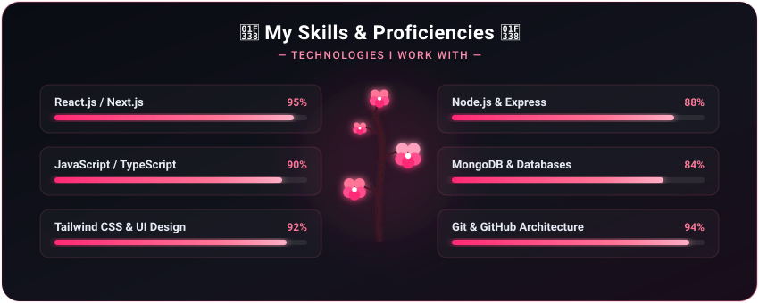

  <!-- ANIMATED HEADER CARD (CUSTOM SAKURA NOIR SVG WITH FALLING PETALS & CIRCUIT GLOW) -->
  

    

  <!-- QUICK ACTION PILLS (WITH LIVE PORTFOLIO) -->
  

    
    &nbsp;
    
    &nbsp;
    
  

  

<!-- ABOUT ME SECTION -->

  

 

  

<!-- TARGET SECTORS & SKILLS DATABASE (FROM PORTFOLIO) -->

  

 

<!-- TECH STACK & TOOLS (BLACK & CHERRY BLOSSOM THEME) -->

  <h3>🌸 Hardware, Simulation &amp; Software Stack 🌸</h3>
  
  

    <strong>VLSI &bull; Digital Electronics &bull; Simulation</strong> 
    
    
    
    
    
  

  

    <strong>Embedded Systems &bull; IoT &bull; Microcontrollers</strong> 
    
    
    
    
    
    
  

  

    <strong>Web Development &bull; Tools &bull; Workflow</strong> 
    
    
    
    
    
    
    
  

 

  

<!-- FEATURED PROJECTS SHOWCASE (DIRECT FROM PORTFOLIO) -->

  <h3>🌸 Featured Engineering Projects 🌸</h3>
   

  <table width="100%" style="border-collapse: collapse; background-color: #06070c; border-radius: 12px; overflow: hidden;">
    <tr>
      <td width="50%" style="padding: 18px; border: 1px solid #ff759733; vertical-align: top;">
        <h4>📡 01. SOS WATCH</h4>
        
<em>LoRa Communication SOS System</em>

        
A wearable emergency communication system designed to send SOS alerts without depending on a mobile phone, using LoRa for long-range wireless communication.

        

          
          
          
        

      </td>
      <td width="50%" style="padding: 18px; border: 1px solid #ff759733; vertical-align: top;">
        <h4>💓 02. PATIENT MONITOR</h4>
        
<em>Real-Time Monitoring System</em>

        
A real-time monitoring system designed to collect and display patient-related information using sensors, embedded systems, and communication technologies.

        

          
          
          
        

      </td>
    </tr>
    <tr>
      <td width="50%" style="padding: 18px; border: 1px solid #ff759733; vertical-align: top;">
        <h4>🤖 03. SMART WAREHOUSE</h4>
        
<em>Package Monitoring System</em>

        
An automated warehouse system designed to monitor and count packages, helping improve tracking efficiency and reduce manual counting efforts.

        

          
          
          
        

      </td>
      <td width="50%" style="padding: 18px; border: 1px solid #ff759733; vertical-align: top;">
        <h4>⚡ 04. PMSM CONTROL</h4>
        
<em>Adaptive PID Auto-Tuning</em>

        
A control-system project focused on automatically tuning PID parameters for a Permanent Magnet Synchronous Motor (PMSM) to improve control performance.

        

          
          
          
        

      </td>
    </tr>
  </table>

 

  

<!-- EDUCATION & BACKGROUND -->

  

 

  

<!-- GITHUB ACTIVITY & STATS (DARK SAKURA THEME) -->

  <h3>🌸 GitHub Activity &amp; Analytics 🌸</h3>
   

  

    <!-- Readme Stats Card -->
    
    &nbsp;
    <!-- Top Languages Card -->
    
  

  

    <!-- Streak Stats -->
    
  

 

  

<!-- CONTACT & GET IN TOUCH -->

  <h3>🌸 Contact &amp; Connect 🌸</h3>
  
Ready to collaborate on a project or share a learning opportunity?

  

    
    &nbsp;
    
    &nbsp;
    
    &nbsp;
    
  

   
  
  

    SANTHIYA.EXE &bull; Built with curiosity &amp; code &bull; 🌸 Black with Cherry Blossom Theme
  

  

